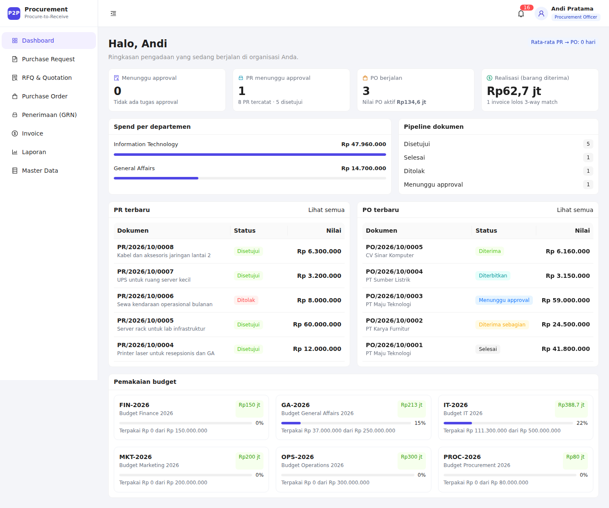
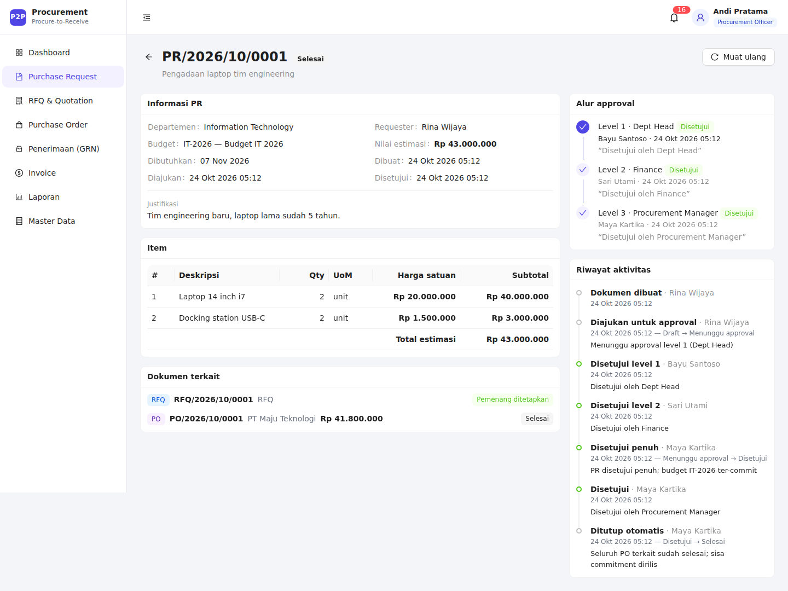
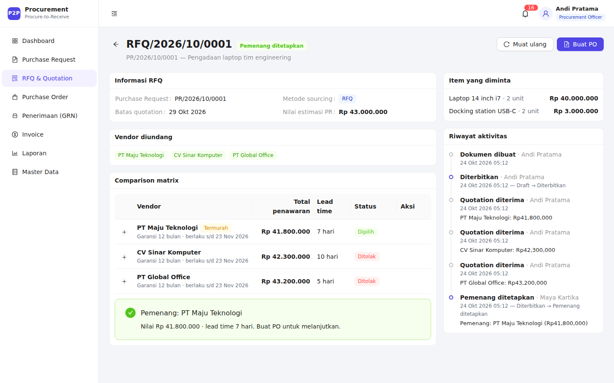
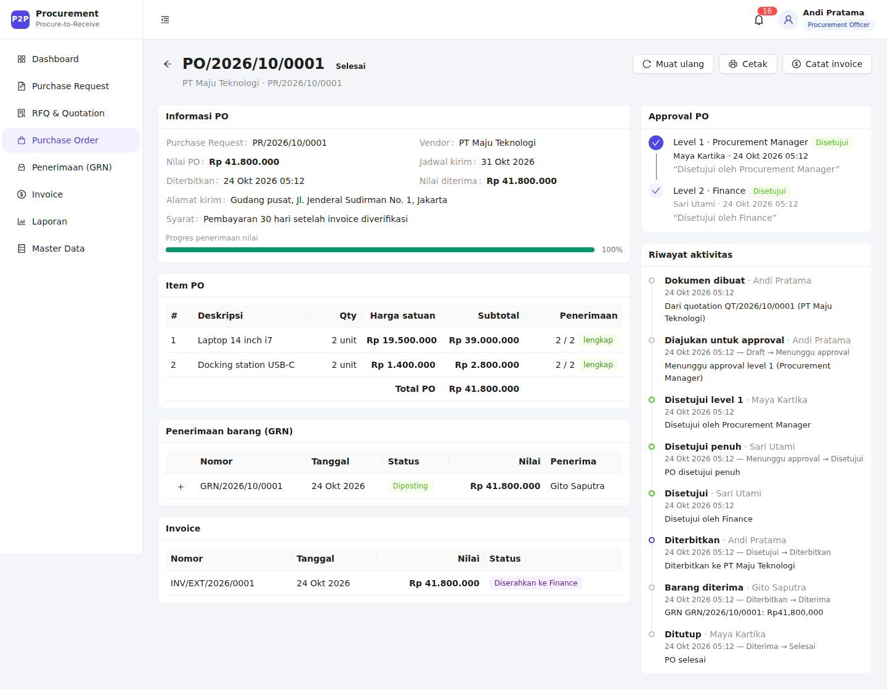
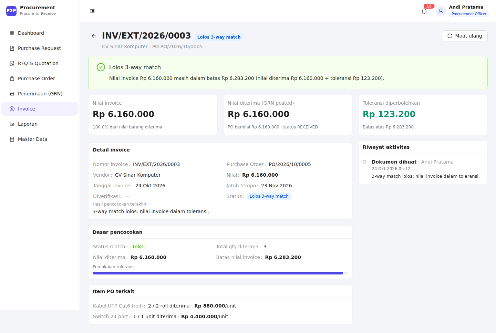
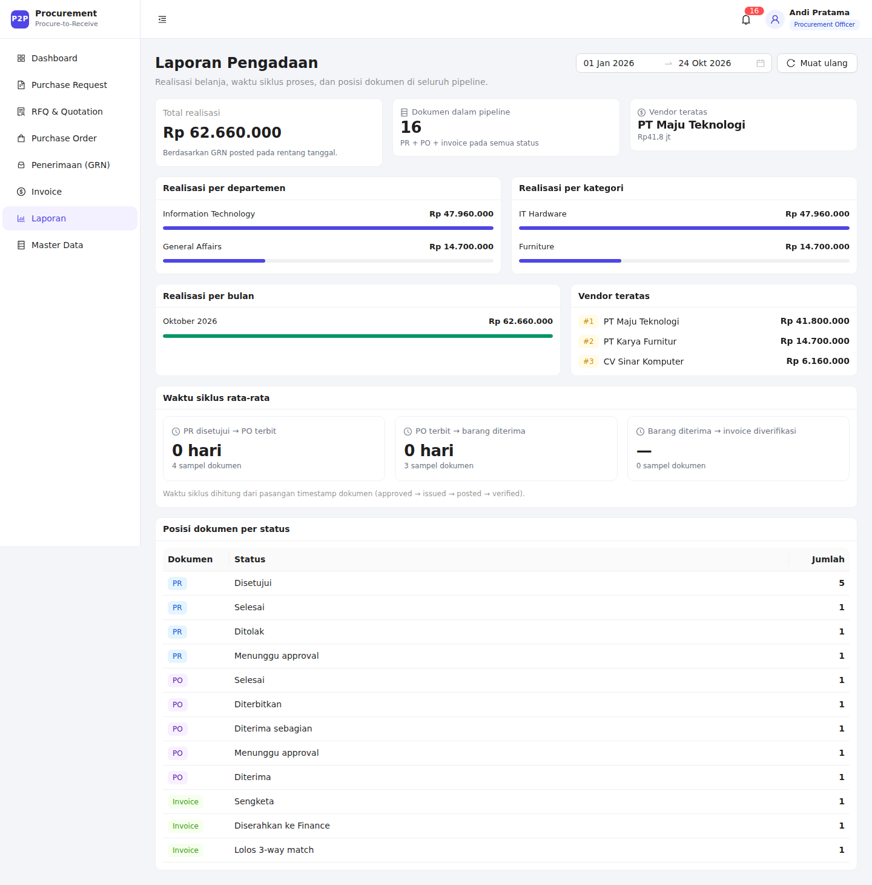

# Procurement P2P — dari Purchase Request sampai Barang Diterima

Aplikasi web pengadaan (procure-to-receive) yang mencakup alur **Purchase Request → approval
berjenjang → RFQ & perbandingan vendor → Purchase Order → penerimaan barang (GRN) → verifikasi
invoice 3-way match**. Dibangun dengan **Flask (Python)** sebagai API dan **React + TypeScript +
Ant Design** sebagai SPA, disajikan dari origin yang sama.

Repositori ini adalah jawaban untuk *Programming Test — Software Engineer (Customer Success)*,
dengan pilihan studi kasus **Aplikasi Procurement**.

---

## 1. Deliverable dan pemetaan ke brief

| Kebutuhan brief | Deliverable | Lokasi |
|---|---|---|
| Riset proses bisnis, dijelaskan dalam markdown | Analisis proses, stakeholder, aturan bisnis, edge case, asumsi | [`docs/01-business-process.md`](docs/01-business-process.md) |
| BPMN/flowchart dengan > 2 role, PDF | Swimlane BPMN + flowchart sourcing + 3 state diagram (Mermaid) | [`docs/02-bpmn.md`](docs/02-bpmn.md), [`docs/export/bpmn-procurement.pdf`](docs/export/bpmn-procurement.pdf) |
| WBS per module & feature dalam Excel | 48 baris pekerjaan (45 selesai, 3 backlog) + 11 baris modul, total 27 hari-orang + sheet Milestone, Approval Matrix, Asumsi & Risiko | [`docs/03-wbs.xlsx`](docs/03-wbs.xlsx) |
| Aplikasi sederhana dengan Flask + database | API + SPA + SQLite, satu repositori | `app/`, `frontend/` |
| Bagian aplikasi Procurement | Seluruh alur P2P di atas, 7 role, audit trail, laporan | halaman `/prs`, `/rfqs`, `/pos`, `/grns`, `/invoices`, `/reports` |
| Analisis data (tambahan) | ERD & aturan integritas | [`docs/04-er-model.md`](docs/04-er-model.md) |

Aset dokumen dapat diregenerasi: `make docs` (WBS via `scripts/build_wbs.py`, PDF via
`scripts/render_diagrams.py`).

---

## 2. Fitur utama

- **Purchase Request (PR)** — draft, submit, revisi setelah ditolak, pembatalan, penomoran otomatis
  `PR/YYYY/MM/NNNN`, validasi budget dan item.
- **Approval berjenjang sekuensial** — matrix berdasarkan nilai dokumen, guard urutan level,
  catatan approve/reject, inbox approval per role, riwayat keputusan.
- **Sourcing** — RFQ/Tender/pembelian langsung, undangan vendor, input quotation, *comparison matrix*
  (total, lead time, garansi), penetapan pemenang dengan aturan jumlah quotation minimum.
- **Purchase Order** — dibuat dari quotation pemenang (harga terkunci), approval matrix terpisah,
  penerbitan, pembatalan, penutupan, **cetak PO** siap PDF.
- **Penerimaan barang/jasa (GRN)** — partial receipt, qty diterima vs ditolak, kondisi
  (`GOOD`/`DAMAGED`/`WRONG_SPEC`/`SHORT`), catatan discrepancy, mode jasa/BAST.
- **Verifikasi invoice 3-way match** — PO ↔ GRN ↔ Invoice dengan toleransi 2% (minimum Rp10.000),
  status `DISPUTED` beserta alasan, verifikasi Finance, handoff ke aplikasi pembayaran.
- **Budget control** — commitment saat PR disetujui penuh, realisasi saat GRN diposting, sisa
  commitment dirilis saat PR ditutup/dibatalkan.
- **Dashboard & laporan** — KPI pipeline, spend per departemen/kategori/bulan, vendor teratas,
  cycle time PR→PO→GRN→invoice, posisi dokumen per status.
- **Audit trail & notifikasi in-app** — activity log append-only untuk setiap transisi status,
  notifikasi per user/role dengan polling ringan.

---

## 3. Pratinjau aplikasi

| Dashboard | Purchase Request |
|---|---|
|  |  |

| Perbandingan quotation | Purchase Order |
|---|---|
|  |  |

| Verifikasi invoice (3-way match) | Laporan |
|---|---|
|  |  |

---

## 4. Arsitektur

Satu repositori, dua bagian yang disajikan sebagai satu origin:

```
Browser ──► Flask (port 5000)
              ├─ /api/*        REST JSON + session cookie
              ├─ /assets/*     hasil build Vite
              └─ /*            SPA fallback → frontend/dist/index.html
```

```
ciheul/
├─ app/
│  ├─ __init__.py          # app factory, error handler, SPA fallback
│  ├─ models.py            # seluruh entity + serializer (single source of truth)
│  ├─ api/                 # blueprint REST: prs, approvals, rfqs, pos, grns, invoices, reports, ...
│  ├─ services/            # state machine, approval matrix, budget, matching, numbering, audit, notifikasi
│  ├─ seed.py              # data demo dibangun lewat HTTP API (sekaligus smoke test)
│  ├─ cli.py               # init-db, seed, seed-reset, demo-accounts
│  └─ config.py
├─ frontend/               # React 19 + TypeScript + Vite + Ant Design + TanStack Query
├─ docs/                   # analisis proses, BPMN, WBS, ERD, PDF
├─ scripts/                # generator WBS & render diagram
├─ tests/                  # pytest: approval, penerimaan, aturan inti
├─ Makefile
├─ pyproject.toml
└─ main.py                 # entry point alternatif (`python main.py`)
```

**Keputusan desain penting**

- **State machine eksplisit** (`app/services/state_machine.py`): setiap transisi divalidasi, sehingga
  tidak ada lompatan status dari API.
- **Uang memakai `Decimal`** dan kolom `NUMERIC(18,2)`; total selalu dihitung ulang di server.
- **Approval matrix berbasis data** (`approval_rules`), bukan `if` bercabang, sehingga mudah diubah.
- **Session cookie same-origin**: tidak ada CORS/JWT; SPA dan API satu origin. Cookie `HttpOnly`,
  `SameSite=Lax`.
- **Seed melalui API** memastikan data demo benar-benar melewati aturan bisnis yang sama dengan UI.

---

## 5. Menjalankan aplikasi

**Prasyarat:** Python ≥ 3.13, [uv](https://docs.astral.sh/uv/), Node.js ≥ 20 (npm).

```bash
# 1. Install dependency Python + frontend
make setup

# 2. (Opsional) konfigurasi lokal
cp .env.example .env

# 3. Buat database SQLite + data demo
make reset-db

# 4. Build SPA lalu jalankan server
make run
```

Buka **http://127.0.0.1:5000** dan login dengan akun demo di bawah.

### Mode pengembangan (hot reload)

```bash
# terminal 1 — API
make dev-api

# terminal 2 — Vite dev server (proxy /api → 127.0.0.1:5000)
make dev-ui
```

Buka **http://127.0.0.1:5173**.

### Perintah lain

| Perintah | Fungsi |
|---|---|
| `make test` | Jalankan seluruh test (`pytest -q`) |
| `make lint` / `make format` | Cek / rapikan style Python (ruff) |
| `make seed` | Isi data demo bila database kosong |
| `make reset-db` | Drop + seed ulang |
| `make build` | Build frontend ke `frontend/dist` |
| `make docs` | Regenerasi WBS dan PDF diagram |

Tanpa `make`:

```bash
uv sync
uv run flask --app app seed-reset
npm --prefix frontend ci && npm --prefix frontend run build
uv run flask --app app run --port 5000
```

---

## 6. Akun demo

Password semua akun: **`demo1234`**. Halaman login menyediakan tombol isi otomatis.

| Role | Email | Departemen | Cocok untuk melihat |
|---|---|---|---|
| Requester | `rina@demo.test` | IT | membuat/mengubah PR, melihat status |
| Requester | `dewi@demo.test` | GA | PR yang ditolak |
| Dept Head | `bayu@demo.test` | IT | approval level 1 |
| Dept Head | `hendra@demo.test` | GA | approval level 1 + penolakan |
| Finance | `sari@demo.test` | Finance | approval budget, verifikasi invoice |
| Procurement Officer | `andi@demo.test` | Procurement | RFQ, quotation, PO, GRN, invoice |
| Procurement Manager | `maya@demo.test` | Procurement | approval, penetapan pemenang, tutup PO/PR |
| Director | `direktur@demo.test` | Board | approval nilai > Rp100 juta |
| Warehouse | `gudang@demo.test` | Operations | penerimaan barang (GRN) |

### Skenario demo yang sudah ter-seed

1. **Laptop tim engineering** — alur lengkap sampai invoice `HANDED_OFF` dan PO/PR `CLOSED`.
2. **Kursi ruang meeting** — penerimaan partial 6 dari 10, 1 unit rusak, invoice `DISPUTED`
   karena melebihi nilai diterima + toleransi.
3. **Monitor ruang desain** — PR menunggu approval Dept Head.
4. **Printer resepsionis** — RFQ dengan 2 quotation, menunggu penetapan pemenang.
5. **Server rack** — PO nilai Rp59 juta menunggu approval Procurement Manager/Finance.
6. **Sewa kendaraan** — PR ditolak Dept Head dengan catatan, siap direvisi.
7. **UPS ruang server** — pembelian langsung (DIRECT) dengan 1 vendor, PO sudah `ISSUED`.
8. **Kabel & switch jaringan** — penerimaan penuh, invoice `MATCHED` menunggu verifikasi Finance.

Alur mencoba cepat:

1. Login `maya@demo.test` → menu **Approval** → setujui PO server rack (PO/2026/10/0003).
2. Login `sari@demo.test` → **Approval** → setujui PO yang sama (level Finance), lalu buka
   **Invoice** → verifikasi `INV/EXT/2026/0003` → serahkan ke Finance.
3. Login `andi@demo.test` → **Purchase Order** → buka PO/2026/10/0003 → **Terbitkan PO**.
4. Login `gudang@demo.test` → **Purchase Order** → **Terima barang** → posting GRN.
5. Cek **Laporan** dan dashboard untuk melihat budget, spend, dan cycle time ikut berubah.

---

## 7. Aturan bisnis yang diterapkan

### Approval matrix (IDR)

| Nilai | PR | PO |
|---|---|---|
| ≤ 10 juta | Dept Head → Finance | Procurement Manager |
| 10–100 juta | Dept Head → Finance → Proc. Manager | Proc. Manager → Finance |
| > 100 juta | Dept Head → Finance → Proc. Manager → Director | Proc. Manager → Finance → Director |

Approval bersifat **sekuensial**; reject menghentikan proses dan PR dapat direvisi
(`REJECTED → DRAFT`). Commitment budget baru dicatat saat approval terakhir PR disetujui.

### Metode sourcing

| Nilai | Default | Vendor minimal |
|---|---|---|
| ≤ 10 juta | `DIRECT` | 1 |
| 10–100 juta | `RFQ` | 3 diundang, 2 quotation untuk award |
| > 100 juta | `TENDER` | 3 diundang, 2 quotation untuk award |

Pengecualian (mis. distributor tunggal/darurat) diperbolehkan dengan justifikasi tertulis.

### Budget

```
available = allocated - committed - spent
```

- `committed` naik saat PR disetujui penuh dan **menempel pada PR**.
- `spent` naik saat GRN diposting; `committed` turun sebesar nilai yang direalisasikan.
- Pembatalan PO tidak merilis commitment; sisa commitment dirilis saat PR dibatalkan atau ditutup.

### 3-way match

Invoice lolos bila sudah ada penerimaan (`GRN POSTED`) dan:

```
amount_invoice ≤ nilai_barang_diterima + max(2% × nilai_diterima, Rp10.000)
```

Invoice yang belum ada penerimaan atau melebihi batas menjadi `DISPUTED` dengan alasan yang
tercatat. Hanya invoice `MATCHED` yang dapat diverifikasi Finance.

### Penomoran

`{TYPE}/{YYYY}/{MM}/{NNNN}` dengan counter per tipe per bulan di dalam transaksi database
(`PR`, `RFQ`, `QT`, `PO`, `GRN`). Invoice memakai nomor invoice vendor dan divalidasi unik.

Detail lengkap, termasuk edge case dan lifecycle status: [`docs/01-business-process.md`](docs/01-business-process.md).

---

## 8. Ringkasan API

Semua endpoint berada di bawah `/api`, memakai session cookie, dan mengembalikan JSON.

| Area | Endpoint utama |
|---|---|
| Auth | `POST /auth/login`, `POST /auth/logout`, `GET /auth/me` |
| Referensi | `GET/POST /budgets`, `/vendors`, `/items`, `GET /departments`, `GET /meta` |
| PR | `GET/POST /prs`, `GET/PUT /prs/:id`, `POST /prs/:id/{submit,revise,cancel,close}` |
| Approval | `GET /approvals`, `GET /approvals/history`, `POST /approvals/:stepId/{approve,reject}` |
| RFQ | `GET/POST /rfqs`, `GET /rfqs/:id`, `POST /rfqs/:id/{issue,quotations,award}` |
| PO | `GET/POST /pos`, `GET /pos/:id`, `POST /pos/:id/{submit,issue,cancel,close}` |
| GRN | `GET/POST /grns`, `GET /grns/:id`, `POST /grns/:id/{post,cancel}` |
| Invoice | `GET/POST /invoices`, `GET /invoices/:id`, `POST /invoices/:id/{recheck,verify,handoff}` |
| Laporan | `GET /dashboard`, `/reports/summary`, `/reports/cycle-time`, `/reports/pipeline` |
| Notifikasi | `GET /notifications`, `POST /notifications/:id/read`, `POST /notifications/read-all` |

Format error konsisten: `{"error": {"message": "...", "status": 4xx}}`.

---

## 9. Test & kualitas

```bash
make test   # 14 tests
make lint   # ruff check + format --check
```

Test berfokus pada aturan yang berisiko:

- `tests/test_approval.py` — urutan approval, matrix nominal, penolakan, commitment budget.
- `tests/test_receiving.py` — partial receipt, qty melebihi PO, discrepancy, 3-way match & toleransi.
- `tests/test_core.py` — penomoran, guard transisi, akses dokumen, seed smoke test.

Seed (`flask seed-reset`) juga menjadi **end-to-end smoke test**: seluruh skenario dibangun melalui
HTTP API yang sama dengan yang dipakai UI.

---

## 10. Asumsi, batasan, dan pekerjaan lanjutan

1. **Live chat widget + mobile app tidak diimplementasikan.** Bagian Procurement pada brief hanya
   mensyaratkan web app (Python) dan database; kalimat tersebut identik dengan brief Helpdesk dan
   dianggap sisa template. Sebagai gantinya tersedia notifikasi in-app. Chat realtime (SSE) tercatat
   sebagai backlog di WBS.
2. **Fitur opsional AI/Computer Vision tidak diimplementasikan** pada iterasi ini; kandidat utama
   (OCR surat jalan untuk prefill GRN) dicatat di WBS.
3. **Vendor belum punya portal**; quotation diinput Procurement Officer berdasarkan dokumen/email.
4. **Gudang dan pembayaran adalah sistem terpisah.** Aplikasi berhenti pada GRN `POSTED` dan invoice
   `VERIFIED`/`HANDED_OFF`, lalu menyediakan data untuk diintegrasikan.
5. Mata uang tunggal IDR, harga belum termasuk pajak, single company/single tenant.
6. Approval belum mendukung delegasi atau approval paralel.
7. Untuk produksi: gunakan PostgreSQL, `SECRET_KEY` kuat, HTTPS, CSRF token, dan WSGI server
   (mis. gunicorn). Konfigurasi demo memakai SQLite agar mudah dijalankan.
8. AI digunakan sebagai alat bantu (scaffolding, review, dokumentasi); keputusan model bisnis,
   aturan, dan verifikasi akhir dilakukan lewat test dan penelusuran manual.

---

## 11. Lisensi & kredit

Kode dibuat untuk keperluan take-home test. Data vendor, user, dan nominal sepenuhnya fiktif.
