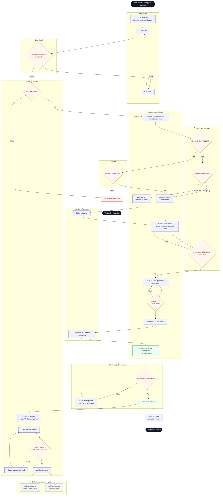
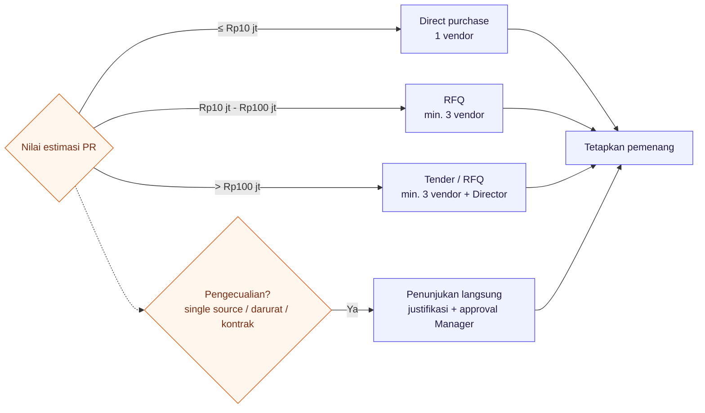
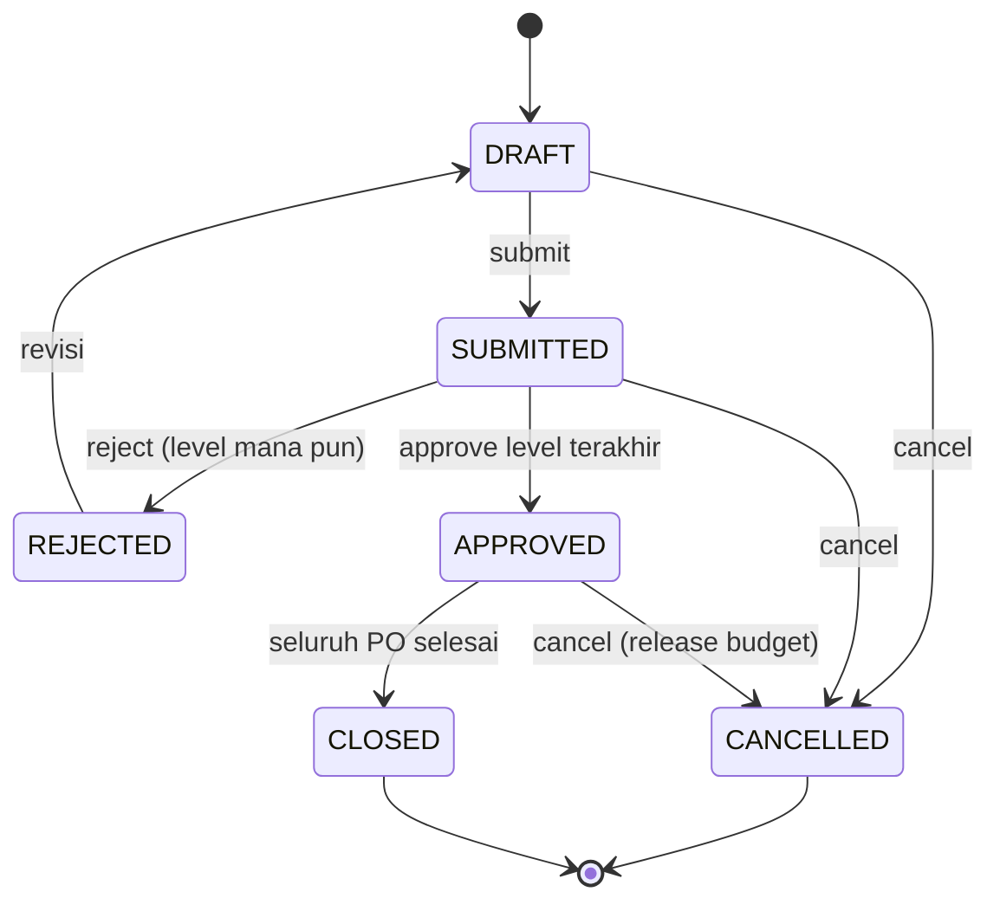
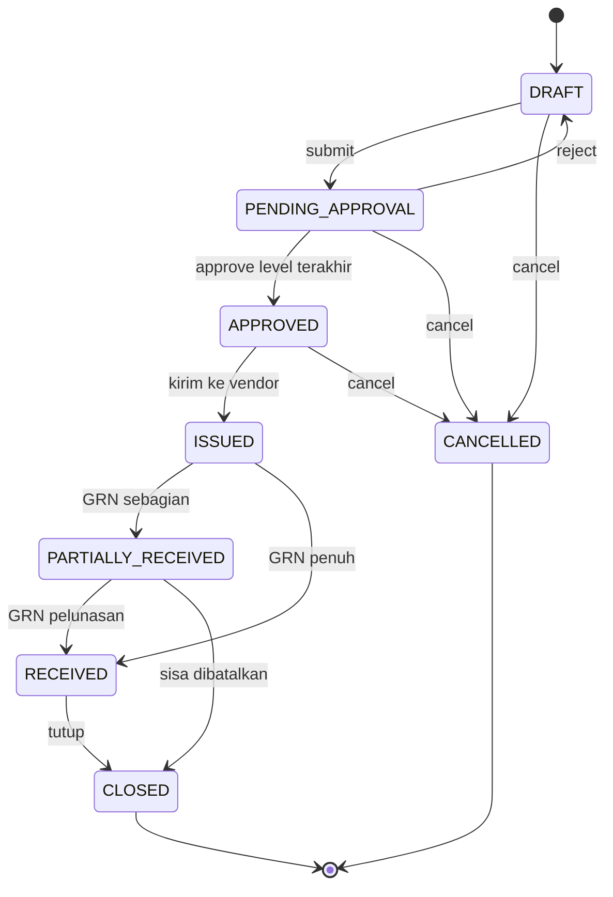
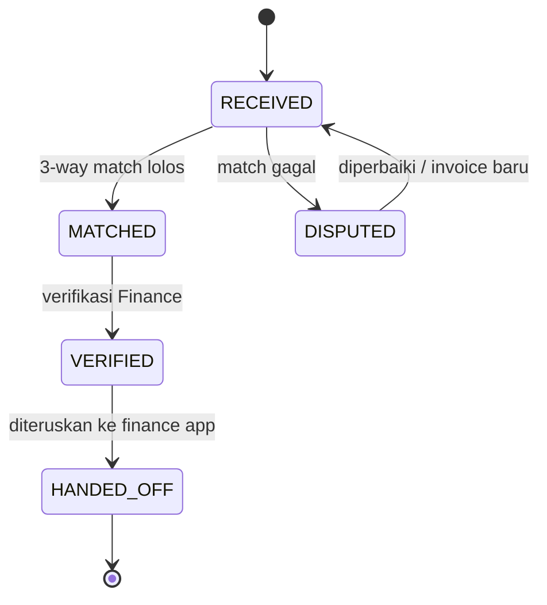

# BPMN / Flowchart Proses Pengadaan

Diagram dibuat dengan **Mermaid** (versi teks, mudah di-diff dan direview) sesuai `AGENTS.md`.
Brief merekomendasikan draw.io/excalidraw dan hasil PDF; sumber mermaid tetap disertakan dan
diekspor ke `docs/export/bpmn-procurement.pdf` agar memenuhi format pengumpulan.

- Sumber diagram utama: [`diagrams/bpmn-procurement.mmd`](./diagrams/bpmn-procurement.mmd)
- Ekspor PDF: [`export/bpmn-procurement.pdf`](./export/bpmn-procurement.pdf)
- Render ulang: `uv run python scripts/render_diagrams.py` (butuh koneksi internet ke kroki.io)
  atau `npx @mermaid-js/mermaid-cli -i <file.mmd> -o <file.pdf>`.

## 1. Swimlane BPMN

Setiap lane adalah role. Garis putus-putus menandai serah terima ke sistem yang **di luar**
ruang lingkup (aplikasi gudang dan aplikasi pembayaran).

Catatan pembacaan:

1. **Jalur utama** (happy path): PR → approval → sourcing → PO → penerimaan → invoice → handoff.
2. **Loop revisi** ada di dua tempat: penolakan PR (kembali ke Requester) dan discrepancy barang
   (kembali ke Vendor untuk penggantian).
3. **Approval PO tidak selalu memerlukan Director**; hanya bila nilai > Rp100 jt.
4. **GRN dan BAST setara secara status**; BAST dipakai untuk pengadaan jasa.
5. **Invoice diverifikasi setelah barang diterima**, bukan setelah PO terbit.

## 2. Flowchart keputusan sourcing

## 3. State machine dokumen

### 3.1 Purchase Request

### 3.2 Purchase Order

### 3.3 Invoice

## 4. Pemetaan diagram → implementasi

| Elemen diagram | Implementasi |
|---|---|
| Approval matrix | `approval_rules` + `services/approval.py` |
| Commit budget | `services/budget.py: commit()`, `spend()` |
| State & guard | `services/state_machine.py` |
| Comparison matrix | endpoint `/api/rfqs/<id>` (quotations + totals) |
| GRN partial & discrepancy | tabel `goods_receipts`, `goods_receipt_items` |
| 3-way match | `services/matching.py` |
| Audit trail | `activity_logs` ditulis di setiap transisi |
| Handoff gudang/finance | status `POSTED` dan `HANDED_OFF` (tanpa integrasi eksternal) |
