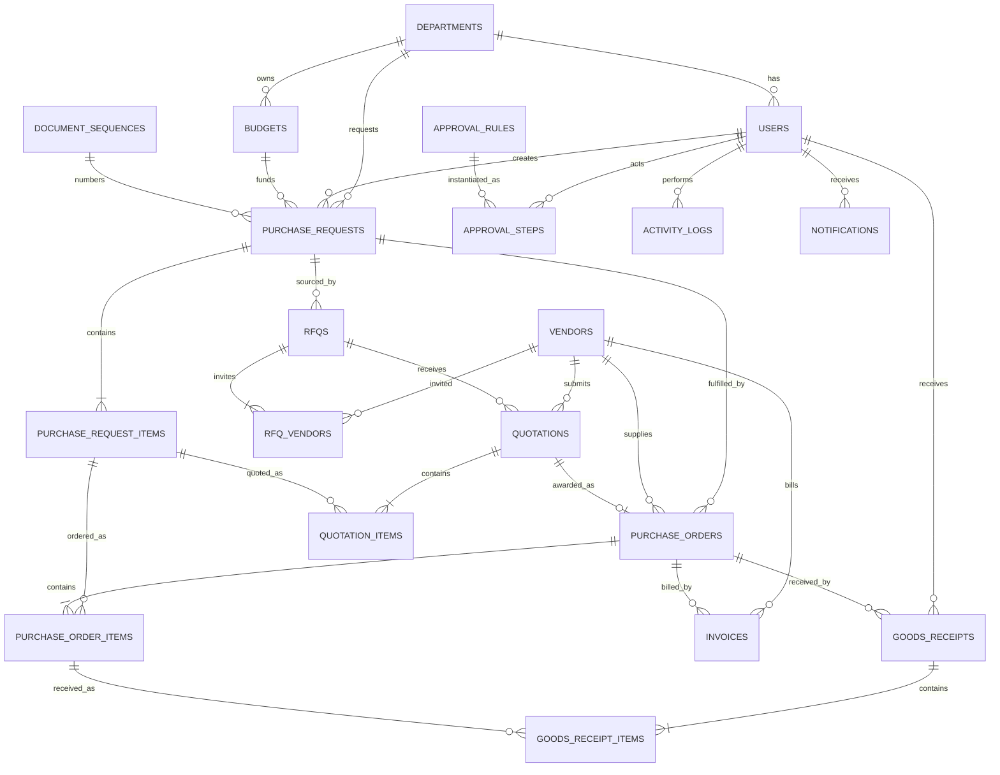

# Model Data (ERD)

Database: **SQLite** (default) melalui SQLAlchemy 2. Semua nilai uang menggunakan
`NUMERIC(18,2)` dan `Decimal` di Python. Semua tabel transaksi memiliki `created_at`,
`updated_at`, dan penomoran dokumen unik.

## Tabel

### Master

| Tabel | Kolom penting | Catatan |
|---|---|---|
| `departments` | `id`, `code`, `name` | Unit pemilik kebutuhan & budget |
| `users` | `id`, `email`, `name`, `password_hash`, `role`, `department_id`, `is_active` | Satu role per user; role menentukan permission |
| `budgets` | `id`, `code`, `name`, `fiscal_year`, `department_id`, `allocated`, `committed`, `spent` | `available` dihitung, tidak disimpan |
| `vendors` | `id`, `code`, `name`, `npwp`, `contact_*`, `address`, `category`, `status`, `rating` | `status` = `ACTIVE`/`BLACKLISTED` |
| `items` | `id`, `code`, `name`, `category`, `uom`, `estimated_price`, `is_active` | Katalog referensi PR |

### Transaksi

| Tabel | Kolom penting | Catatan |
|---|---|---|
| `purchase_requests` | `number`, `department_id`, `requester_id`, `budget_id`, `status`, `total_estimated`, `needed_date`, `justification` | Header PR |
| `purchase_request_items` | `pr_id`, `item_id?`, `description`, `qty`, `uom`, `estimated_price`, `subtotal` | `item_id` opsional (barang non-katalog) |
| `rfqs` | `number`, `pr_id`, `method`, `status`, `deadline`, `notes` | `DIRECT`/`RFQ`/`TENDER` |
| `rfq_vendors` | `rfq_id`, `vendor_id`, `invited_at`, `responded_at` | Undangan vendor |
| `quotations` | `number`, `rfq_id`, `vendor_id`, `status`, `total`, `lead_time_days`, `warranty`, `valid_until`, `notes` | `SELECTED` hanya satu per RFQ |
| `quotation_items` | `quotation_id`, `pr_item_id`, `qty`, `unit_price`, `subtotal` | Harga penawaran |
| `purchase_orders` | `number`, `pr_id`, `quotation_id`, `vendor_id`, `status`, `total`, `delivery_date`, `delivery_address`, `terms`, `issued_at` | Satu quotation → maksimal satu PO |
| `purchase_order_items` | `po_id`, `pr_item_id`, `description`, `qty`, `uom`, `unit_price`, `subtotal`, `received_qty` | `received_qty` kumulatif |
| `goods_receipts` | `number`, `po_id`, `received_by`, `received_date`, `status`, `delivery_note_no`, `notes` | GRN/BAST |
| `goods_receipt_items` | `grn_id`, `po_item_id`, `qty_received`, `qty_rejected`, `condition`, `note` | Partial & discrepancy |
| `invoices` | `number`, `po_id`, `vendor_id`, `invoice_date`, `due_date`, `amount`, `status`, `match_notes`, `verified_by` | Verifikasi saja, bukan pembayaran |

### Kontrol & audit

| Tabel | Kolom penting | Catatan |
|---|---|---|
| `approval_rules` | `doc_type`, `min_amount`, `max_amount`, `sequence`, `role` | Matrix approval, seed-able |
| `approval_steps` | `doc_type`, `doc_id`, `sequence`, `role`, `status`, `actor_id`, `acted_at`, `note` | Satu baris per level per dokumen |
| `document_sequences` | `doc_type`, `period`, `last_number` | Penomoran `TYPE/YYYY/MM/NNNN` |
| `activity_logs` | `doc_type`, `doc_id`, `action`, `from_status`, `to_status`, `actor_id`, `notes`, `created_at` | Append-only, ditampilkan sebagai timeline |
| `notifications` | `user_id`, `title`, `message`, `link`, `is_read`, `created_at` | Notifikasi in-app |

## Aturan integritas

1. **Uang**: `Decimal` + `Numeric(18,2)`, pembulatan `ROUND_HALF_UP`. Total selalu dihitung server.
2. **Status**: hanya boleh berubah via service (state machine), tidak dari endpoint langsung.
3. **Unik**: `number` per dokumen, `email`, `budget.code`, `vendor.code`, `item.code`,
   dan kombinasi `(doc_type, doc_id, sequence)` pada approval steps.
4. **Cek constraint**: qty > 0, harga ≥ 0, `received_qty ≤ qty` (divalidasi di service karena
   melibatkan agregasi antar tabel).
5. **Penghapusan**: dokumen transaksi tidak dihapus, hanya `CANCELLED` (jejak audit tetap ada).
6. **Concurrency**: transisi memakai `SELECT ... FOR UPDATE` (Postgres) / transaksi tunggal
   (SQLite) + guard status, sehingga approve ganda gagal dengan aman.
